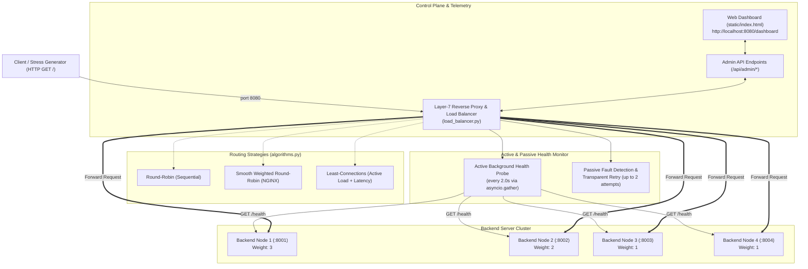

# Dynamic Layer-7 HTTP Load Balancer & Health Monitor

A high-performance, asynchronous Layer-7 HTTP Reverse Proxy and Load Balancer built in Python with `aiohttp`. Features real-time hot-swappable load balancing algorithms, active concurrent health probing, passive fault detection with transparent client retries, and a dark-mode telemetry dashboard with live metrics, charts, and interactive fault injection.

---

## Architecture Overview



---

## Core Engineering Features

### 1. High-Performance Asynchronous Layer-7 Reverse Proxy
- **Non-blocking Concurrency:** Implemented with `aiohttp.web` and a shared `aiohttp.ClientSession` featuring pooled TCP connections (`limit=500`, `limit_per_host=200`, `use_dns_cache=True`).
- **Standard Header Forwarding:** Forwards `X-Forwarded-For` and client headers while sanitizing hop-by-hop transport headers. Injects routing metadata headers in responses (`X-LB-Node-ID`, `X-LB-Node-Port`, `X-LB-Algorithm`, `X-LB-Retries`).

### 2. Hot-Swappable Load Balancing Algorithms
1. **Round-Robin (`round_robin`):**
   - Sequentially cycles requests across healthy nodes ($i = (i + 1) \pmod N$).
   - Automatically skips nodes marked unhealthy.
2. **Smooth Weighted Round-Robin (`weighted_round_robin`):**
   - Implements NGINX's smooth weighted round-robin algorithm.
   - Nodes with larger integer weights receive proportionally more requests without clustering (e.g. weights `3:2:1:1` are smoothly interleaved across requests).
3. **Least-Connections (`least_connections`):**
   - Selects the healthy node with the lowest active in-flight connection count (`active_connections`).
   - Dual tie-breaking: selects the node with the lowest moving-average latency, followed by the highest configured weight.

### 3. Dual-Tier Health Monitoring & Automatic Failover
- **Active Health Probing:**
  - A background `asyncio` task concurrently queries `GET http://127.0.0.1:{port}/health` on all backends every `2.0 seconds` via `asyncio.gather`.
  - Measures probe latency for telemetry.
  - If a node fails `2` consecutive probes (HTTP 500/503, timeout, or connection refusal), it is marked `UNHEALTHY` and removed from the active routing pool.
  - When an `UNHEALTHY` node successfully responds `200 OK` on a subsequent probe, it is automatically marked `HEALTHY` and reinstated into the pool.
- **Passive Fault Detection & Transparent Retries:**
  - In-flight client requests track active connections inside a strict `try...finally` block.
  - If a chosen backend crashes mid-request or returns an HTTP `500`/`502`/`503` error, the load balancer immediately marks that node `UNHEALTHY` and transparently retries the request on the next available healthy backend (up to 2 retries). The client receives a clean `200 OK` with zero perceived downtime.

### 4. Real-Time Telemetry & Control Dashboard
- Accessible at `http://localhost:8080/dashboard`.
- Single-page application styled with Tailwind CSS (CDN) and Chart.js (CDN) in a high-contrast dark mode.
- **KPI Bar:** Live Algorithm badge, Total Requests, Total Retries, Success Rate (%), Cluster Moving Average Latency, and Active In-Flight Connections.
- **Algorithm Switcher:** Zero-downtime hot-swapping between Round-Robin, Smooth WRR, and Least-Connections.
- **Traffic Generator & Stress Tester:**
  - "Fire 50 Requests" (concurrent batch)
  - "Fire 200 Requests" (high-concurrency batch)
  - "Continuous Traffic Stream (10 req/s)" live toggle
- **Interactive Backend Node Cards (8001 - 8004):**
  - Live status badge (`HEALTHY` in emerald / `UNHEALTHY` in red).
  - Metrics: Active Connections, Total Handled (% share), Last Health Latency, Average Latency.
  - Controls: Weight stepper (`1` to `10`), Artificial Latency injection (`0ms`, `100ms`, `300ms`, `800ms`), and instant "Kill Node / Recover Node" toggle.
- **Real-Time Visualizations:**
  - Chart.js dynamic bar chart of request distribution per node.
  - Live terminal log streaming requests, status codes, latencies, and highlighting failover retries in amber/red.

---

## File Structure

```
minip/
├── algorithms.py       # Core routing algorithms (RR, Smooth WRR, Least-Connections, Router)
├── backend_node.py     # Configurable backend HTTP server with fault injection
├── load_balancer.py    # Layer-7 Reverse Proxy, health monitor, telemetry, & admin API
├── run_cluster.py      # Master cluster orchestrator (spawns 4 nodes + LB with colored logs)
├── static/
│   └── index.html      # Dark-mode telemetry control dashboard UI
├── test_lb.py          # Automated test suite (algorithm units, router, and integration tests)
├── requirements.txt    # Python dependencies (aiohttp, pytest, pytest-asyncio)
├── run_project.bat     # 1-Click Windows launcher script
└── README.md           # Documentation
```

---

## Quickstart

### Option A: 1-Click Launch (Windows)
Double-click [`run_project.bat`](file:///c:/Users/Abhinandan%20Singh/Desktop/COLLEGE%20STUFF/5CN/minip/run_project.bat) or run from command prompt:
```cmd
run_project.bat
```
This automatically verifies dependencies from `requirements.txt`, launches all 5 processes, and opens `http://localhost:8080/dashboard` directly in your default browser.

### Option B: Manual Launch
1. Ensure Python 3.10+ is installed:
   ```bash
   pip install -r requirements.txt
   ```
2. Run the master orchestrator to spawn all 4 backend nodes (ports 8001–8004) and the load balancer (port 8080):
   ```bash
   python run_cluster.py
   ```

Outputs will stream with colored process tags:
```
============================================================
    Dynamic Layer-7 Load Balancer Cluster Orchestrator     
============================================================
[*] Reverse Proxy Host:    http://127.0.0.1:8080/
[*] Telemetry Dashboard:  http://localhost:8080/dashboard
[*] Backend Cluster:       8001, 8002, 8003, 8004
[*] Press Ctrl+C at any time to safely shut down cluster.
```

Open your browser to:
- **Telemetry & Control Dashboard:** `http://localhost:8080/dashboard`
- **Reverse Proxy Route:** `http://localhost:8080/`

Press `Ctrl+C` to gracefully terminate all 5 processes simultaneously.

---

## Running the Automated Test Suite

Run pytest to programmatically verify all algorithmic behaviors, tie-breaking rules, admin endpoints, and active/passive failovers:

```bash
pytest test_lb.py -v
```

All 12 test cases verify:
1. Exact sequential cycling in Round-Robin.
2. Skipping unhealthy nodes in Round-Robin.
3. Proportional 3:2:1:1 request distribution in Weighted Round-Robin.
4. Smooth non-clustering interleaving in Smooth WRR.
5. Least-Connections routing to the least loaded server.
6. Latency-based tie-breaking in Least-Connections.
7. Algorithm router hot-swapping and error validation.
8. End-to-end HTTP reverse proxying and transparent retry failover on crash.
9. Admin API metrics, algorithm updates, and stats reset.
10. Active health probe crash detection (2 failures) and automatic recovery.
11. Backend node dynamic config endpoint and weight updates.

---

## Admin API Endpoints

| Method | Endpoint | Description |
| :--- | :--- | :--- |
| `GET` | `/dashboard` | Serves the single-page telemetry dashboard |
| `GET` | `/api/admin/metrics` | Returns cluster and node telemetry JSON |
| `POST` | `/api/admin/algorithm` | Hot-swaps routing algorithm (`{"algorithm": "round_robin"}`) |
| `POST` | `/api/admin/node/{id}/config` | Updates node weight, latency, or crash state (`{"weight": 3, "delay_ms": 100, "is_crashed": false}`) |
| `POST` | `/api/admin/reset` | Resets all telemetry counters and logs |
| `POST` | `/api/admin/stress` | Triggers a concurrent batch of internal requests (`{"count": 50}`) |
| `GET` | `/health` | Active probe check on backend nodes (`200 OK` or `503 Unavailable`) |
| `POST` | `/config` | Fault-injection endpoint on backend nodes |

---

## License

Academic / MIT License. Developed for Computer Networks (5CN).
